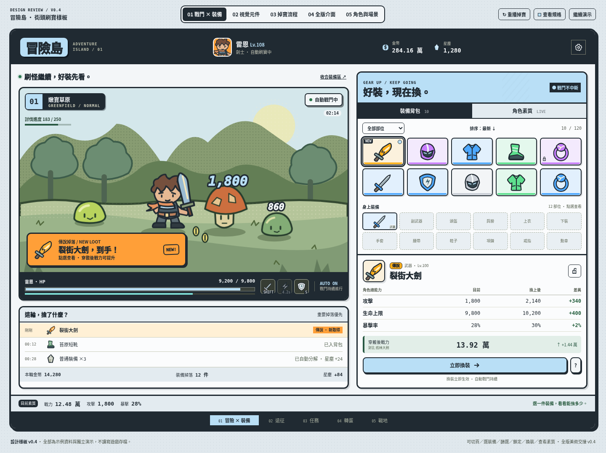

# Adventure-Island

原生 JavaScript＋Canvas 2D 遊戲。當前協作交付為 **v0.4 淺藍、平順粗線的全版美術設計包**；保留左戰鬥／右裝備管理，優先掉寶、裝備與角色素質。

[下載完整實作交接包](handoff/v0.4/Adventure-Island-Art-Handoff-v0.4.zip) · [實作 Prompt](handoff/v0.4/IMPLEMENTATION_PROMPT.md) · [七張樣板截圖與開啟方式](design/mockups/v0.4/README.md)

## 使用

樣板：直接開啟 `design/mockups/v0.4/index.html`，可切換戰鬥×裝備、視覺元件、掉寶流程、全版介面、角色與場景五頁；可示範換裝、鎖定、篩選與素質更新。資料獨立，不讀寫遊戲存檔。

原遊戲：`game/index.html` 保持使用者上傳位元，尚未套用新版美術／即時換裝。可直接開啟，或於根目錄執行 `python -m http.server 8000 --bind 127.0.0.1` 後開啟 http://127.0.0.1:8000/game/ 。存檔依瀏覽器來源區分。

語法檢查：`python tools/check_syntax.py`（Python、Node.js）。ZIP 解壓後執行根目錄 `python verify_package.py` 驗證內容。

## 實作交接與記憶

- [handoff/v0.4](handoff/v0.4/README.md)：Prompt、全版規格、44個SVG的使用說明、tokens、47列覆蓋清單、實作順序與驗收。
- [AGENTS.md](AGENTS.md)：協作入口；每次接手先讀。
- [STATUS](docs/STATUS.md)、[DECISIONS](docs/DECISIONS.md)、[ADR](docs/decisions/ADR-002-light-blue-smooth-contours.md)：進度、已確認方向與決策來源。
- [ART-INVENTORY](docs/ART-INVENTORY.md)、[LIVE-GEAR](docs/LIVE-GEAR.md)：原碼盤點與即時換裝整合規則。
- docs/reference/、docs/reviews/baseline/：原始資料與未修改版本截圖。DOCX是背景，不自動視為新指令。

本端負責需求、美術樣板與交接；正式遊戲由實作端套用。v0.2／v0.3保留歷史，現行視覺規格以v0.4為準。
