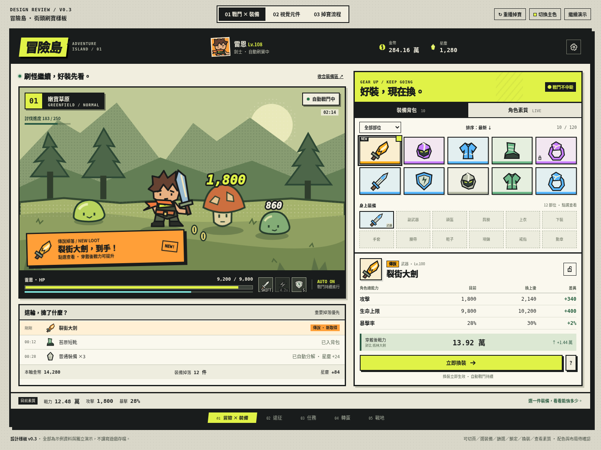
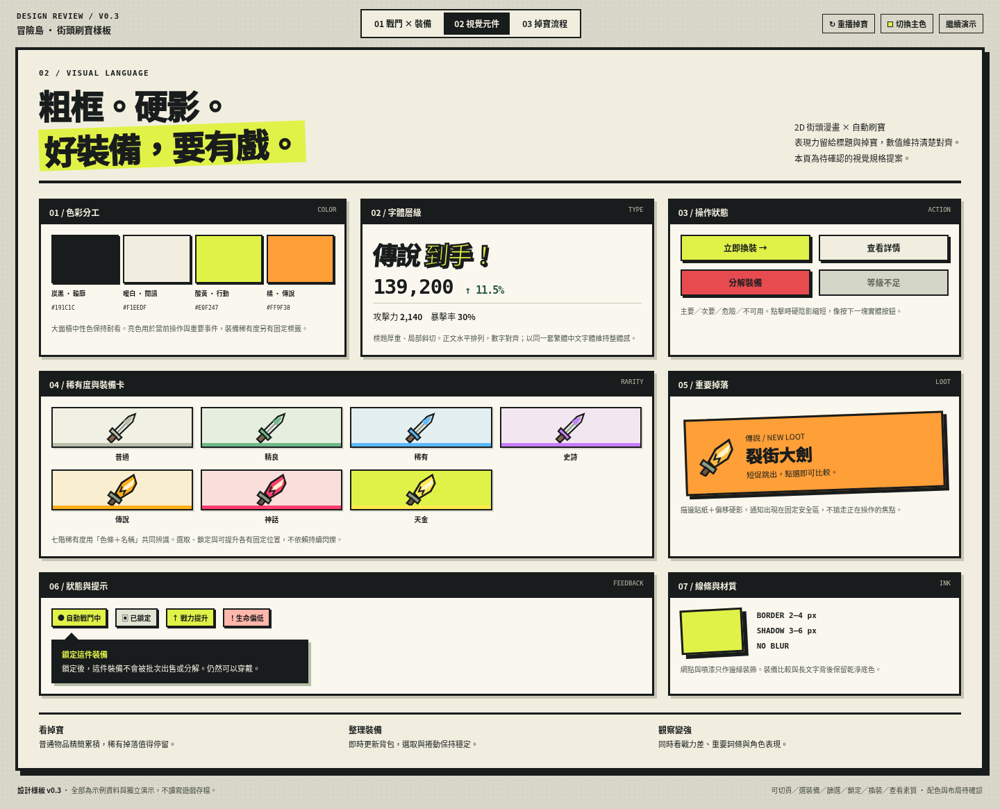
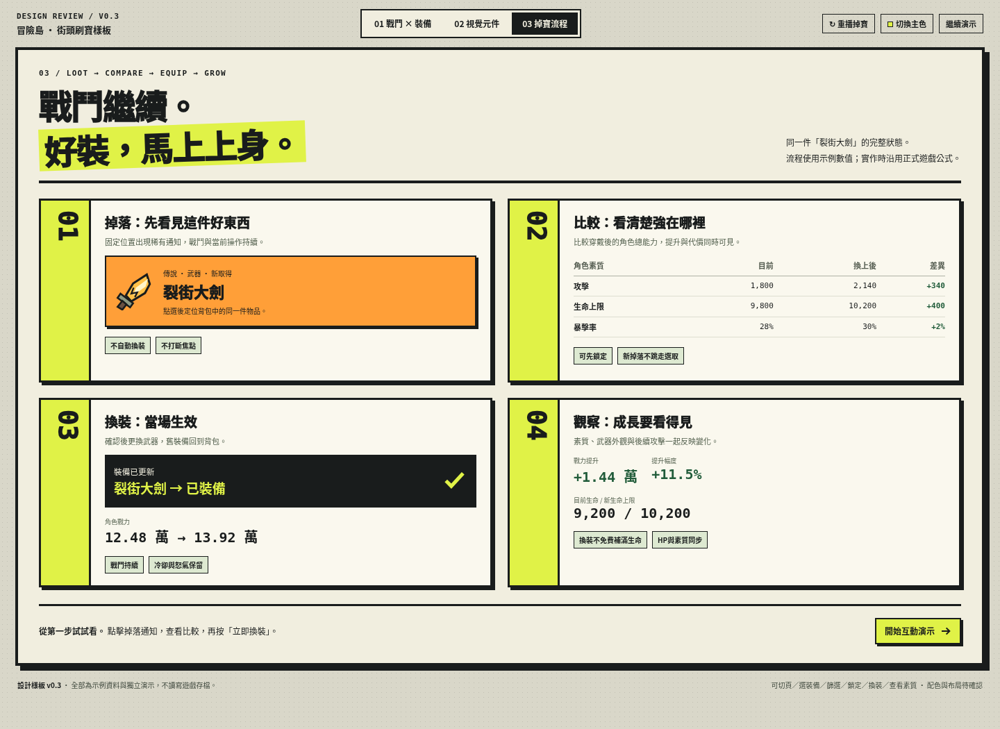
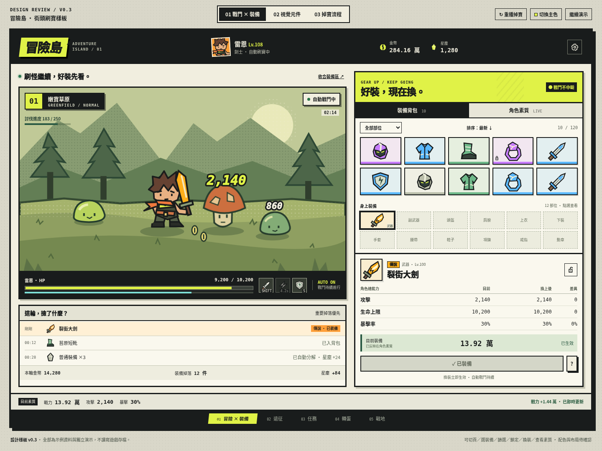
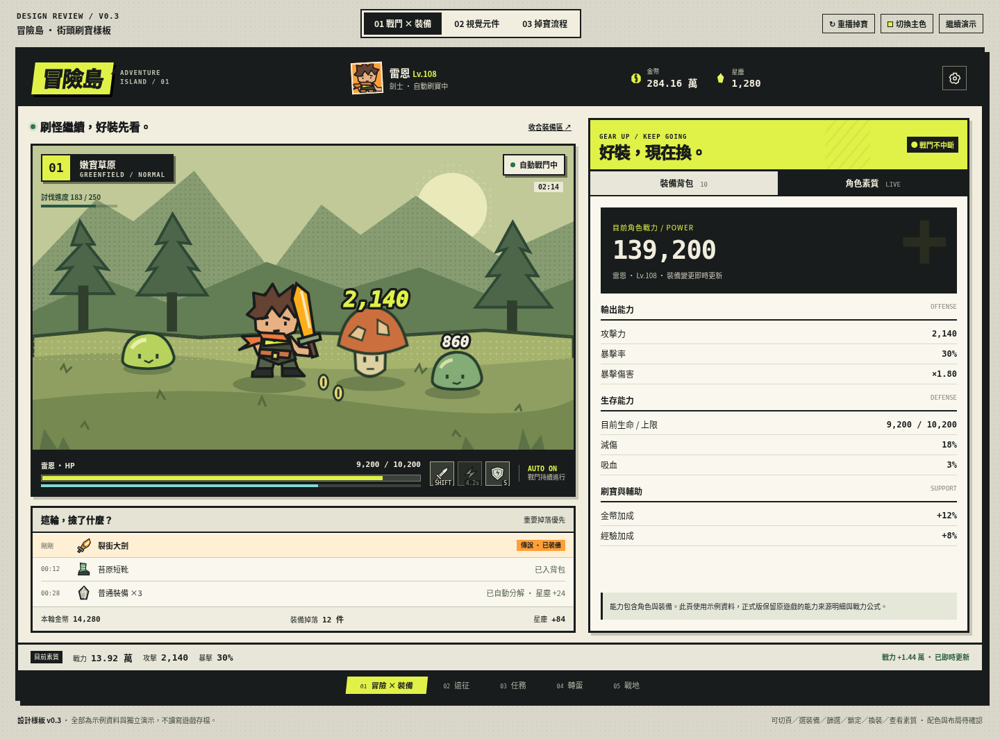

# 冒險島：街頭刷寶樣板 v0.3

這是一份設計討論樣板，使用獨立示例資料。原始遊戲 game/index.html 保持不變。

## 檢視方式
下載本目錄內 Adventure-Island-Mockups-v0.3.zip，解壓後用桌機瀏覽器開啟 index.html；所有圖示、插圖、樣式與程式都已包含在單一HTML，無須網路或安裝。
也可在專案根目錄執行 `python -m http.server 8000 --bind 127.0.0.1`，開啟 `http://127.0.0.1:8000/design/mockups/v0.3/`。

## 三組樣板
1. 戰鬥 × 裝備：戰鬥可見、即時背包、12部位穿戴區、角色能力比較與素質頁。
2. 視覺元件：色彩、字體、按鈕、七階稀有度、掉寶通知、提示與狀態。
3. 掉寶流程：取得→比較→換裝→素質更新的連續狀態。

可操作：切頁、重播掉寶、篩選／排序、選裝備、鎖定、換裝、素質頁、收合管理區、酸黃／橘色主色比較及暫停演示。
點「重播掉寶」後，點掉落通知，再按「立即換裝」，即可看到示例戰力由12.48萬變13.92萬，HP維持9200、新上限10200，武器與後續示意數字也更新。
底部遠征／任務／轉蛋／戰地為導航外觀示意，不是假裝可用的按鈕。

## 先看畫面
### 01 戰鬥與裝備

### 02 視覺元件

### 03 掉寶到換裝

### 換裝後與角色素質

## 本輪請討論
- 粗框、硬影、貼紙與漫畫字的力度是否符合期待？
- 酸黃或橘色主操作色，哪個更適合遊戲？
- 左戰鬥／右背包比較的布局，是否符合自動刷寶習慣？
- 角色素質摘要與詳情的資訊量是否足夠？

圖示、角色與場景為本輪製作的原創SVG概念示意，尚未決定替換原遊戲資產。使用系統繁體中文字型，未打包第三方字型。
詳細交接邊界與驗證見 DESIGN-NOTES.md、REVIEW-PROMPT.md、VALIDATION.md。
