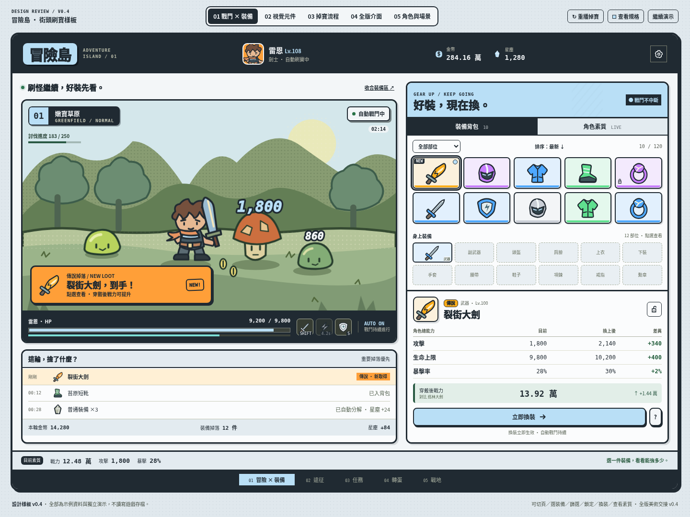
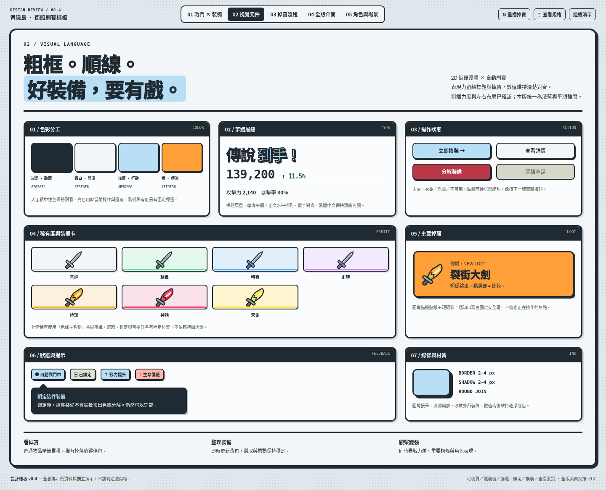
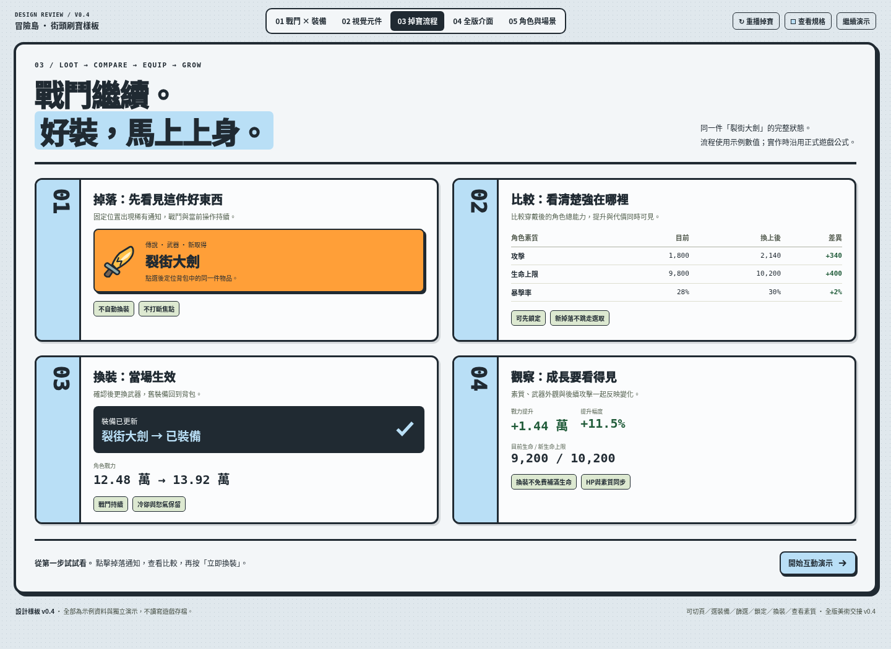
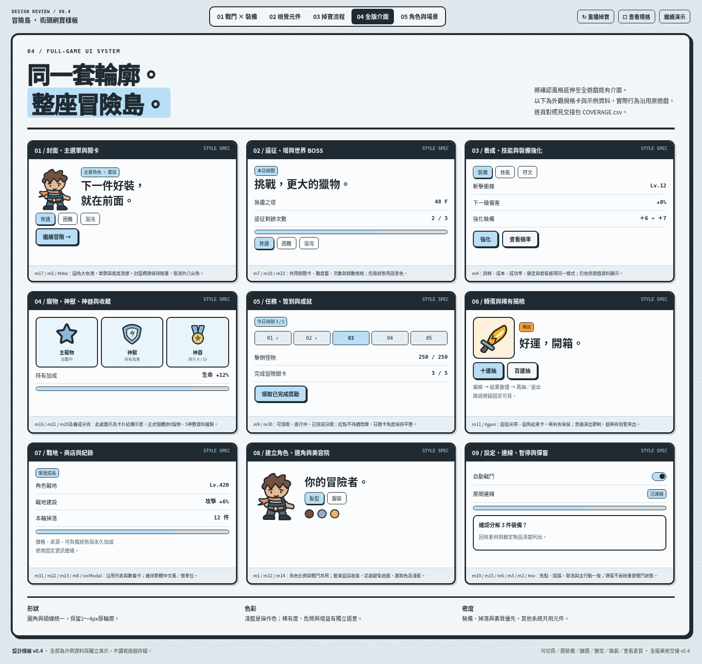
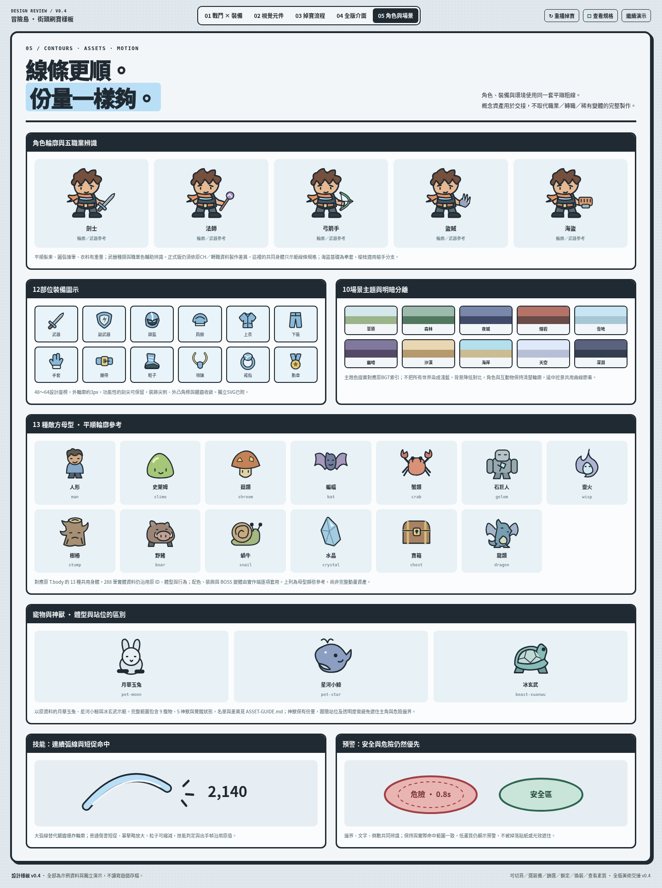
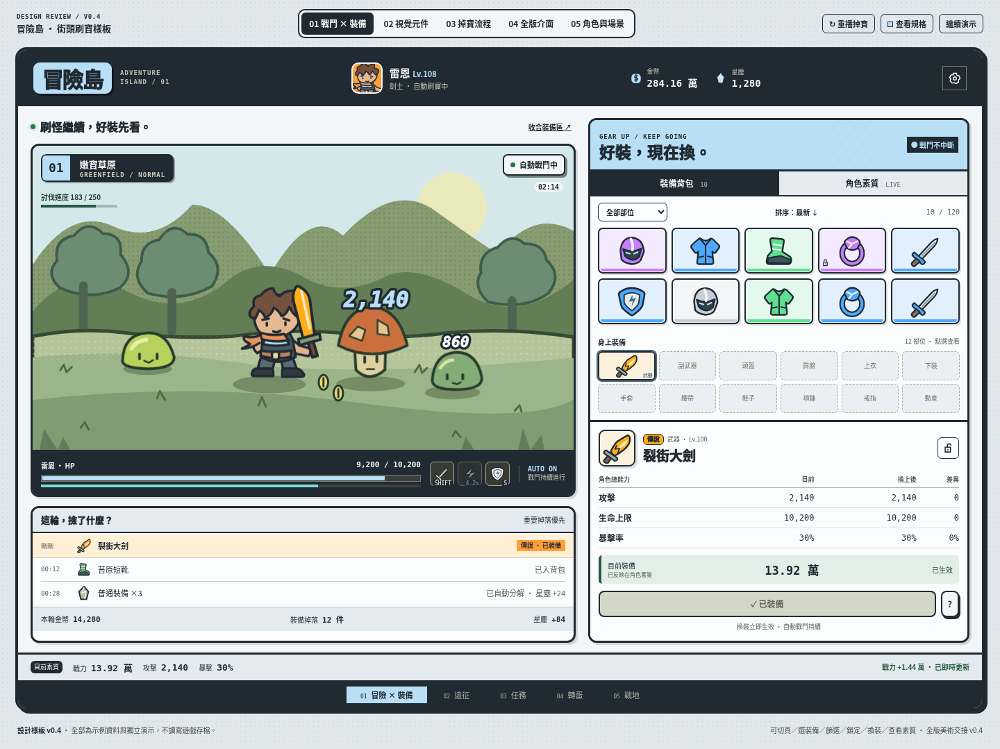
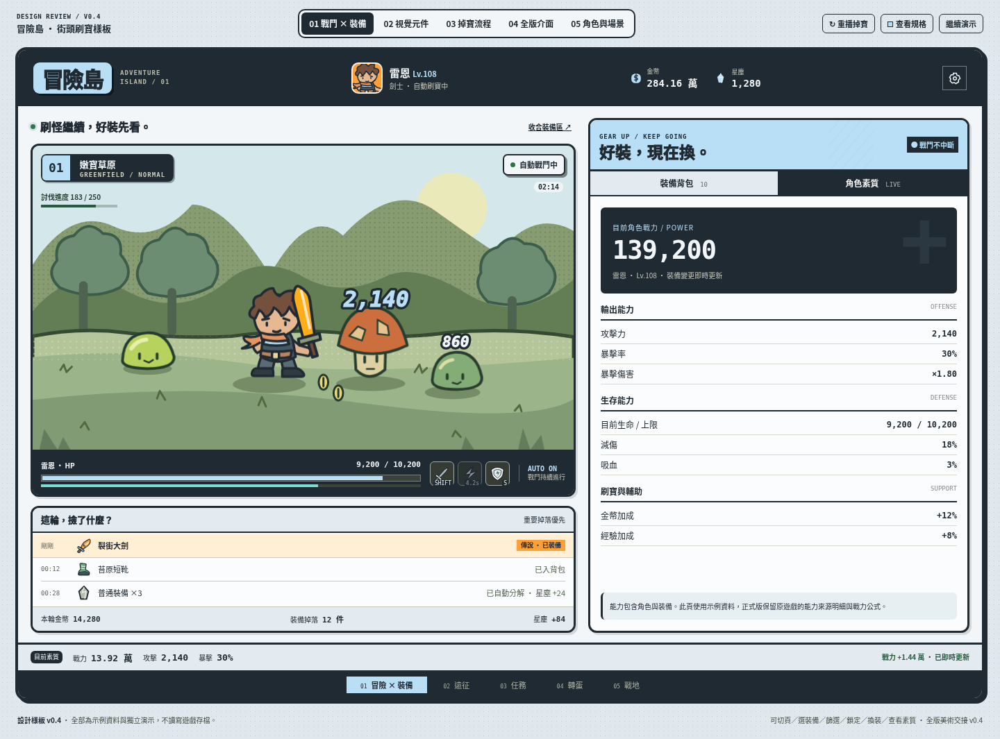

# v0.4 樣板：淺藍 × 平順粗線

新實作端先讀根目錄 [START-HERE](../../../START-HERE.md)，其中連結完整背景／需求／目前進度與新聊天室Prompt。

保留粗硬份量與左右布局；圓角接筆、減少外凸尖角與斜切。主操作淺藍，稀有度／危險仍保有獨立語意。

[下載最新完整專案ZIP](https://github.com/LoHAs-hub/Adventure-Island/archive/refs/heads/work.zip) · [實作Prompt](../../../handoff/v0.4/IMPLEMENTATION_PROMPT.md)

解壓後開啟此目錄的 index.html，可切換五個頁籤、重播掉寶、選物／篩選／鎖定／換裝、看素質、收合管理與暫停演示。若瀏覽器限制直接開啟本機檔案，於解壓根目錄執行 `python -m http.server 8000 --bind 127.0.0.1`，開啟 http://127.0.0.1:8000/design/mockups/v0.4/ 。不需要外部圖片、字型或網路服務。

示例資料獨立，不讀寫原遊戲存檔。「暫停演示」是設計檢視工具；正式遊戲中的裝備管理不停止戰鬥。全版介面頁是系統樣式卡；角色／怪物為靜態參考，完整動畫與變體由實作端套用。

## 戰鬥與裝備

## 視覺元件

## 掉寶流程

## 全版介面

## 角色、怪物、夥伴與場景

## 換裝後與角色素質

樣板驗證見 VALIDATION.md。精確規格與全範圍對照以 handoff/v0.4 為準。
